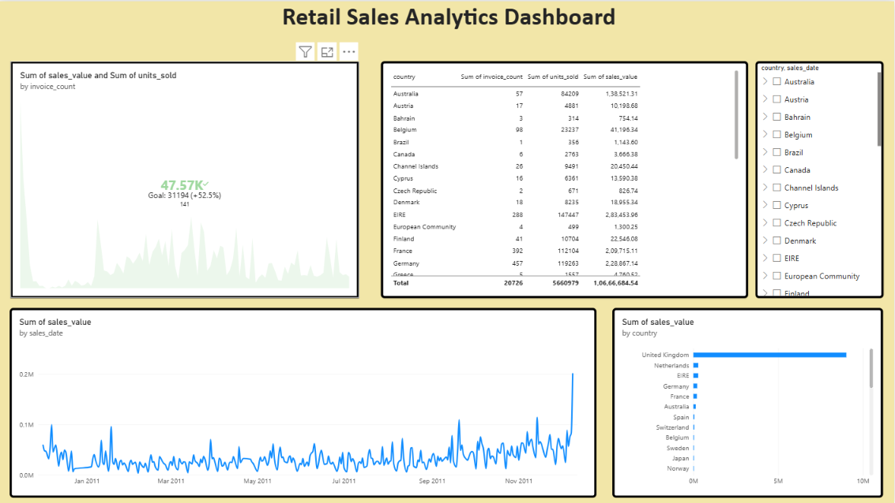

# gcp-retail-sales-pipeline
# End-to-End Retail Sales Data Engineering Pipeline on GCP

An end-to-end data engineering project that processes retail sales data using Google Cloud Platform (GCP), BigQuery, Dataform, Python, SQL, and Power BI.

## Project Overview

This project demonstrates how raw retail transaction data can be ingested, validated, transformed, and analyzed to generate meaningful business insights.

The pipeline uses the Online Retail dataset and follows a cloud data warehouse architecture with separate raw, staging, and analytical layers.

## Architecture

```text
Online Retail Dataset (Excel/CSV)
              |
              v
       Python Ingestion
       Data Validation
              |
              v
       Google Cloud Storage
              |
              v
       BigQuery - Raw Layer
              |
              v
        Dataform + SQL
              |
              v
     BigQuery - Staging Layer
              |
              v
      BigQuery - Analytics
              |
              v
       Power BI Dashboard
```

## Technology Stack

- **Programming:** Python
- **Data Processing:** Pandas
- **Query Language:** SQL
- **Cloud Platform:** Google Cloud Platform (GCP)
- **Data Lake / Storage:** Google Cloud Storage
- **Data Warehouse:** BigQuery
- **Transformation & Workflow Management:** Dataform
- **Visualization:** Power BI
- **Version Control:** Git and GitHub

## Key Features

- Retail transaction data preparation and ingestion.
- Python-based data validation.
- Cloud storage and BigQuery integration.
- SQL-based data cleaning and transformation.
- Dataform-managed transformation models.
- Analytical queries for sales and invoice insights.
- Power BI dashboard for business reporting.
- Version-controlled code and architecture documentation.

## Business Insights

The analytical layer supports questions such as:

- Which countries generate the highest sales?
- What are the total sales and invoice counts?
- Which products contribute most to revenue?
- How do sales trends change over time?



## Project Structure

```text
gcp-retail-sales-pipeline/
├── data/
├── ingestion/
│   ├── prepare_dataset.py
│   ├── validate_data.py
│   └── load_to_bigquery.py
├── dataform/
│   ├── definitions/
│   └── workflow_settings.yaml
├── sql/
├── dashboard/
├── tests/
├── docs/
│   └── architecture.md
├── .gitignore
├── requirements.txt
└── README.md
```

## Setup and Execution

1. Clone the repository:

   ```bash
   git clone https://github.com/Sanatan25/gcp-retail-sales-pipeline.git
   cd gcp-retail-sales-pipeline
   ```

2. Create and activate a Python virtual environment:

   ```bash
   python -m venv .venv
   ```

   Windows PowerShell:

   ```powershell
   .\.venv\Scripts\Activate.ps1
   ```

3. Install dependencies:

   ```bash
   pip install -r requirements.txt
   ```

4. Prepare and validate the dataset using the scripts in `ingestion/`.

5. Configure your GCP project and load the prepared data into BigQuery.

6. Execute the Dataform transformation workflow.

7. Connect Power BI to the analytical BigQuery tables or views and refresh the dashboard.

**Note:** GCP project configuration, permissions, and authentication are required for cloud execution.

## Data Quality

The project is designed to validate incoming data and apply SQL checks for required fields and valid numeric values before producing analytical outputs.

## Cost Management

- Avoid unnecessary scheduled executions during development.
- Run BigQuery queries only when needed.
- Review query processing estimates before execution.
- Disable or remove unused cloud resources.

## Future Improvements

- Automate ingestion and transformation scheduling.
- Add more comprehensive automated data-quality assertions.
- Implement pipeline monitoring and failure alerts.
- Add incremental data loading for new transactions.

## Repository

[GitHub: gcp-retail-sales-pipeline](https://github.com/Sanatan25/gcp-retail-sales-pipeline)

## Author

Sanatan Senapati

Interested in Data Engineering, Cloud Computing, Analytics, and AI.
